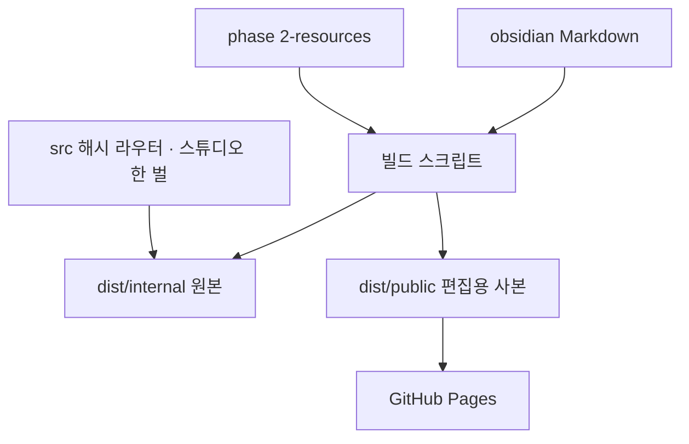

# AX Design Studio

Pages: [https://woongs2021.github.io/AX-DESIGN-TOOL/](https://woongs2021.github.io/AX-DESIGN-TOOL/) — [Graphic Library](https://woongs2021.github.io/AX-DESIGN-TOOL/#/) · [Online Studio](https://woongs2021.github.io/AX-DESIGN-TOOL/#/studio) · [Conference](https://woongs2021.github.io/AX-DESIGN-TOOL/#/conference) · [History](https://woongs2021.github.io/AX-DESIGN-TOOL/#/history)

아카이브된 디자인 작업물을 기반으로 **온라인 마케팅 브랜드 에셋**(인스타그램, 페이스북, 유튜브 커버, 쇼츠 등)을 만드는 정적 웹 툴이다. 디자인 이미지는 Obsidian Markdown vault에 아카이빙하고, 웹은 빌드된 JSON과 자산만 읽는다.

현재 상태: **Phase 2 Conference 구현**. 네비는 **Graphic Library / Online Studio / Conference / History**다. 2026-10-20에 연사 사진과 로고 공개를 허락하고 Conference를 GitHub Pages에도 열었다. 2026-10-25에 배경을 `[Graphic_Resources] 2`로 바꾸고, 연사별 인스타그램 카드·PDF·무한 루프 GIF·그룹·색 보정을 더했다. 그 레이아웃을 앱 기본값으로 넣었고, 공개 사이트도 100MB 이하 원본 배경을 쓴다. `#/intake`, `#/design-system`, `#/stats`는 `#/studio`로 이동한다.

## Phase 요약

| Phase | 목표 | 상태 | 문서 |
|---|---|---|---|
| 0 Archive Foundation | vault 스키마, 결정적 빌드, internal/public 이중 번들, Archive·상세 UI, 접근성 감사, 로컬 ingest·design-system CLI. 예전 Phase 0~8을 하나로 통합했다. | 완료 | [docs/phase-0-foundation.md](docs/phase-0-foundation.md) |
| 1 Online Studio | 35개 아카이브 작업물을 테마로 SNS 규격 마케팅 카드를 만들고 PNG로 다운로드하는 툴 | 구현됨 | [docs/phase-1-online-marketing-studio.md](docs/phase-1-online-marketing-studio.md) |
| 2 Conference | 컨퍼런스 행사물(Instagram, Poster, Slide, X배너, L배너)을 같은 편집기로 만든다. 배경 이미지·동영상, PNG, PDF, 인쇄용 PNG, MP4, 무한 루프 GIF, 연사·로고. 로컬과 Pages 모두 100MB 이하 원본 | 구현됨 | [docs/phase-2-conference-studio.md](docs/phase-2-conference-studio.md) |

## Phase 0 — Archive Foundation

**목표**: 디자인 이미지를 Obsidian vault에 아카이빙하고, 빌드된 JSON만 읽는 정적 웹에서 탐색하는 기반을 만든다. 예전 Phase 0~8을 이 단계로 묶었다. Phase 1 Online Studio는 이 기반 위에서 아카이브 이미지를 소재로 쓴다. 세부 내용은 [Phase 0 문서](docs/phase-0-foundation.md)에 있다.

**개발 순서**

| 단계 | 내용 | 상태 |
|---|---|---|
| 0-1 | 토큰 단일 원천, 대비 검증, focus-visible, coarse pointer 터치 타깃, LF 정규화 | 완료 |
| 0-2 | Markdown 스키마, vault 구조, 통제 어휘, visibility, LLM Wiki index/log | 완료 |
| 0-3 | 결정적 JSON, 자산 프로브, 태그 정규화, 중복 감지, internal/public 이중 번들, 빌드 리포트 | 완료 |
| 0-4 | 앱 셸, 해시 라우터, Archive 그리드, 검색·필터, 다크 모드, 키보드 접근 | 완료 |
| 0-5 | 상세 뷰. Collections·Wiki·Export 화면과 Related captures는 제품 UI에서 제거 | 완료 |
| 0-6 | 대비·키보드·터치 감사, public 누출 점검, Pages 용량, 수동 배포 | 완료 |
| 0-7 | 로컬 `npm run ingest`로 vault 저장과 LLM 분석 초안. Intake 탭은 Phase 1에서 제거 | CLI |
| 0-8 | `npm run design-system`으로 `design-system.md`·`tokens.json` 초안. Design System 탭은 Phase 1에서 제거 | CLI |
| 0-9 | 디자인 시스템 기반 마케팅 이미지 생성 | Phase 1로 대체 |

**핵심 계약**

- `obsidian/` Markdown이 진실이다. 웹은 `dist/<target>/data/index.json`과 복사된 자산만 읽는다.
- vault는 `obsidian/captures/<slug>/`, `obsidian/collections/`, `obsidian/wiki/`로 나뉜다.
- 치수·바이트·포맷·해시처럼 파일에서 계산되는 값은 Markdown에 쓰지 않고 빌드가 만든다.
- `internal`은 전체, `public`은 `visibility: public`만 포함한다. public은 internal 데이터를 빼놓고 만든다.
- ingest, 빌드, 배포는 사람이 명령으로 실행한다. 브라우저는 LLM 키를 갖지 않는다.
- UI 색상 hex는 `src/shared/tokens.css`에만 둔다.

## Phase 1 — Online Studio 계획 요약

**목표**: 지금 아카이브된 이미지를 기반으로 온라인 마케팅 브랜드 에셋을 제작하는 툴을 만든다. 산출물은 인스타그램, 페이스북, 유튜브 커버, 쇼츠 등 여러 규격으로 만들 수 있다. 도형·선·펜과 그 점 편집까지 같은 카드 안에서 만든다.

**개발 순서** — 세부 계획과 구현은 [Phase 1 문서](docs/phase-1-online-marketing-studio.md)의 같은 번호에 있다.

| 단계 | 내용 |
|---|---|
| 1-1 | 네비를 Graphic Library / Online Studio / History로 바꾸고 `#/studio`로 들어온다 |
| 1-2 | 컨트롤 패널과 프리뷰, 카드 크기·글자·이미지·색·PNG·코드 영역 |
| 1-3 | 폰트 분리, 초기화, 다크 모드, 라이브러리 정리 |
| 1-4 | 비율을 유지한 크기 조절, 줌, Fit, 되돌리기 |
| 1-5 | 좁은 화면, 디바이스 뷰, 핀치, 글자 바로 수정 |
| 1-6 | 여러 객체 선택, 정렬, 복제, 단축키 |
| 1-7 | 레이어, 객체 메뉴, 크롭, 이미지 출처와 업로드 |
| 1-8 | 글자 스타일, 스포이드, 방향키, 복사·붙여넣기 |
| 1-9 | 프리셋 그리드, 크기 스텝, 프리셋별 초기화 기준 |
| 1-10 | 테마 20점에서 35점, 4K 원본, 사이트용 3072 |
| 1-11 | 내장 초기화 기준, 프리셋 썸네일, 폰트 함께, Online Studio 이름, 로딩 문구 |
| 1-12 | 원·사각형·삼각형·별, 선, 펜 |
| 1-13 | 그림자, 블렌드, 레이어 블러, 그라데이션, 테두리 |
| 1-14 | 점 편집, 별과 도형의 radius 점, 핸들 모양, 도구 정의 |

**IA 변경**
- Intake, Design System, Stats 탭을 없애고 **Online Studio** 한 탭(`#/studio`)으로 정리한다. 네비는 Graphic Library / Online Studio / History가 된다.
- 예전 `#/intake`, `#/design-system`, `#/stats` 주소는 `#/studio`로 리다이렉트한다.
- `npm run ingest`, `npm run design-system` CLI는 탭과 별개로 유지한다.
- 상세 뷰에 `이 테마로 만들기` 링크를 두어 해당 작업물을 테마로 선택한 채 스튜디오로 들어간다.

**화면 구성**

[Online Studio](https://woongs2021.github.io/AX-DESIGN-TOOL/#/studio)는 왼쪽 컨트롤 패널과 오른쪽 프리뷰로 나뉜다.

```text
┌──────────────────────────── AX DESIGN STUDIO ─────────────────────────────┐
│ Control panel (좌)          ┃ Preview (우)                               │
│ ┌ [Design] [Code] 탭 ─────┐ ┃                                            │
│ │ 카드 크기 프리셋         │ ┃      ┌──────────────────┐                  │
│ │ 도형 / 선 / 펜           │ ┃      │   카드 프리뷰     │                  │
│ │ 너비 / 높이 (바 + 수치)  │ ┃      │   (실제 비율)     │                  │
│ │ 타이틀 / 본문 + 폰트 크기│ ┃      └──────────────────┘                  │
│ │ 폰트                     │ ┃                                            │
│ │ 아카이브 테마 (35개)     │ ┃  1080 × 1080 · Instagram Feed              │
│ │ 이미지 크기              │ ┃                        [PNG 다운로드]      │
│ │ 컬러 / radius            │ ┃                                            │
│ └─────────────────────────┘ ┃                                            │
└────────────── 드래그 분할 바 ┃────────────────────────────────────────────┘
```

- 좌측은 **컨트롤 패널**, 우측은 **프리뷰**. 768px 이상(태블릿·데스크톱)에서는 가운데 바를 드래그해 두 영역의 너비를 조절한다. 767px 이하 모바일은 프리뷰 위, 컨트롤 아래로 쌓고, 헤더는 로고·모드 버튼 한 줄과 메뉴 한 줄로 줄인다. 헤더 아래에는 모바일·타블렛·데스크탑 뷰 아이콘이 있다. 화면 폭에 따라 하나, 둘, 셋이 보이고, 누르면 컨트롤 패널과 프리뷰가 그 화면으로 함께 바뀐다. 아이콘에는 원형 테두리가 없고, 모바일·타블렛 프레임 좌우에도 선이 없다. 프레임 스크롤바는 스크롤할 때만 콘텐츠 위에 겹친다. 프리뷰 폭이 좁으면 하단 바가 크기 정보, 편집·줌 버튼, 다운로드 버튼 순으로 줄바꿈된다. 프리뷰는 `−` / `+`로 확대·축소하고, `Fit`을 누르면 사방 10px 여백을 두고 100%로 맞춘다. 현재 카드의 실제 픽셀 크기 PNG로 다운로드한다. 첫 방문의 화면 모드는 다크다.
- 컨트롤 패널은 **디자인 영역**과 **코드 영역** 두 탭으로 나눈다.
- **Graphic Library**(예전 Archive)는 스튜디오에 쓸 그래픽을 모아 둔 화면이다. 제목 아래 설명 문장과 `Target … · N · N pinned` 줄을 두고, 검색창·필터 없이 All/Pin 탭으로만 나눈다. 카드 테두리는 공통 선보다 연하다.
- 프리뷰에는 이전 동작·원래대로 버튼이 있고, 드래그하는 동안만 잡은 요소에 테두리가 보인다. 단축키는 이전 동작 Cmd/Ctrl+Z, 원래대로 Cmd+Shift+Z · Ctrl+Y다(글자 입력칸 안에서는 브라우저 기본 동작).
- 프리뷰에서 타이틀·본문·이미지를 클릭하면 선택되고, Shift+클릭으로 여러 개를 선택하거나 하나만 뺀다. 선택된 객체를 끌면 함께 움직이고, 한 개 이상 선택하면 프리뷰 위에 정렬 바(왼쪽·수평 가운데·오른쪽·위쪽·수직 가운데·아래쪽은 카드 배경에 맞추고, 세 개 이상이면 가로·세로 균등 정렬)가 뜬다. Option(맥)·Alt(윈도우)+드래그는 선택을 복제해 끈다. 방향키는 0.5px, Shift+방향키는 10px씩 옮긴다. 프리뷰 확대·축소는 Cmd/Ctrl와 +/− 또는 Cmd(맥)·Ctrl(윈도우)+휠이다. 카드 요소는 레이어로 쌓이며(기본: 이미지 맨 아래, 그 위 본문·타이틀), 오른쪽 클릭 또는 롱프레스 메뉴로 복사·붙여넣기·맨 위로/맨 밑으로 보내기·크롭하기(이미지)·삭제를 한다. Cmd/Ctrl+C·V로도 복사·붙여넣기하고, Delete(맥 ⌫)로 지운다. I는 스포이드로, 선택한 텍스트가 있으면 그 글자 색을 모두 바꾸고, 선택된 텍스트가 없으면 카드 배경색을 찍는다. 타이틀·본문은 굵기(Light·Regular·Medium·SemiBold·Bold), 볼드·이탤릭·밑줄과 왼쪽·가운데·오른쪽 정렬을 패널 버튼으로 바꾼다. 분할 바는 옅은 색이고, 조절바의 빈 트랙은 라이트·다크 모드 모두에서 보이게 칠한다.

**디자인 영역 컨트롤**

| 컨트롤 | 형태 |
|---|---|
| 카드 크기 | SNS 기본 규격 프리셋. 진입 시 Instagram Feed 1080 × 1080 자동 선택. 너비·높이는 바 + 수치로 100~4000px 직접 조절. 둘을 한 번에 조절하는 바는 비율을 유지한 채 프레임과 이미지를 함께 키우거나 줄이고, 폰트는 그대로 둔다 |
| 도형 | 프리셋 아래의 원·사각형·삼각형·별·선·펜. 한 번 누르면 동그란 크기 점과 마름모 radius 점, 두 번 누르면 점의 위치와 작은 파란색 휘어짐 점. 그림자, 블렌드, 레이어 블러, 그라데이션, 테두리 |
| 카드 타이틀 / 본문 | 텍스트 input / textarea. 시작값은 `Hello`와 헤르메스 본문 초안. 타이틀은 Montserrat 100px, 본문은 Pretendard 32px. 입력 즉시 프리뷰 반영. 프리뷰에서 드래그해 위치 이동하고, 더블 클릭하면 그 자리에서 수정. 글자색은 각각 원형 컬러 피커(모드에 맞는 30% 테두리) |
| 폰트 크기 | 타이틀·본문 각각 range 바 + 수치. 최소 5px, 최대는 카드 너비 − 20px. 텍스트를 두 개 이상 선택하면 `폰트 크기 함께`가 나타나고, 가장 큰 글자를 기준으로 선택된 글자가 같은 비율로 커지거나 줄어든다 |
| 폰트 | 타이틀·본문 각각 선택. Roboto, Pretendard, Montserrat. `fonts/`에 폰트 파일을 넣고 다시 빌드하면 목록에 추가 |
| 초기화 | 현재 프리셋의 기준 레이아웃으로 되돌린다. 기준은 `초기화로 세팅`으로 브라우저에 저장하고, 저장한 것이 없으면 `src/shared/studio-defaults.json`의 8개 프리셋 내장 기준을 쓴다. 설정 메뉴의 리셋은 저장한 기준만 지우고 내장 기준으로 돌아간다. 패널 너비는 유지 |
| 아카이브 테마 | 35개 아카이브 작업물 썸네일 중 하나를 선택한 이미지 레이어(없으면 맨 아래 이미지)에 적용. 원본을 불러오는 동안 오른쪽 회색 프리뷰 가운데에 `이미지를 로딩중입니다...`가 14px로 보이고, 글자 투명도가 반복해서 변한다. 프리뷰로 끌어다 놓으면 새 이미지 레이어로 삽입. 끝의 `+`로 이미지를 추가(이 브라우저에 저장, ×로 삭제) |
| 카드 이미지 | 너비 바 + 수치(100~4000px, 높이는 원본 비율). 이미지 radius는 0~120px, 처음 값 12px. 프리뷰에서 드래그해 위치 이동. 핀치하거나 클릭 후 상하좌우 핸들로 크기 조절 |
| 카드 컬러 | 원형 컬러 피커 + hex 입력. 타이틀·본문 시작색은 대비에 맞춘 흑 또는 백 |
| 카드 radius | range 바 + 수치 입력 동기화(0~120px, 기본 28px), CSS 변수로 적용 |

**카드 크기 프리셋**(초기화 레이아웃을 실제 비율로 줄인 이미지가 들어간 그리드, 크기 조절바 옆 −/+는 2px · Shift 10px): Instagram Feed 1080×1080(기본), Instagram Portrait 1080×1350, Instagram Story/Reels 1080×1920, Facebook Feed 1200×630, Facebook Cover 1640×624, YouTube Thumbnail 1280×720, YouTube Channel Cover 2560×1440, YouTube Shorts 1080×1920.

**코드 영역**: HTML + CSS 조각을 붙여 넣으면 sandbox iframe 안에서 프리뷰로 렌더한다. 스크립트는 실행하지 않는다. 디자인 영역 값은 CSS 변수와 `{{title}}`·`{{body}}`·`{{themeImage}}`·`{{image:<출처>}}` 치환자로 이어지고, `현재 디자인을 코드로 복사`로 디자인 상태를 코드로 내보낸다.

**경계**: 서버·LLM 호출 없이 브라우저 안에서만 합성한다. 생성물은 vault와 배포 번들에 저장하지 않는다.

**확인 필요**: Samsung Sharp Sans 추가 가능 여부, 테마 색을 카드 기본값으로 가져올지, 카드 초안을 파일로 여러 장 내보낼지, 아카이브 이미지의 마케팅 사용 권리. 코드 영역은 HTML+CSS로 구현되어 있다. 상세는 Phase 1 문서의 `확인 필요` 표를 따른다.

## 업데이트 기록

| 날짜 | 변경 |
|---|---|
| 2026-10-27 | 저장해 둔 포스터, 슬라이드, X배너, L배너 레이아웃을 앱 기본값으로 다시 넣었다. 인스타그램 카드와 순서는 그대로다. |
| 2026-10-27 | Instagram, Poster, Slide, X배너 배경 동영상을 color MP4로 바꿨다. 포스터 동영상은 2880 × 3840이다. L배너에는 동영상이 없다. |
| 2026-10-25 | 저장해 둔 포스터, 슬라이드, X배너, L배너 레이아웃을 앱 기본값으로 넣었다. 인스타그램 연사 카드 세 장의 위치도 지금 기준으로 맞췄다. 저장값이 없는 브라우저도 같은 카드로 열린다. |
| 2026-10-25 | 브라우저에 저장해 둔 인스타그램 카드 4장과 포스터 레이아웃, 카드 순서를 앱 기본값으로 넣었다. 저장값이 없는 브라우저도 같은 카드로 열린다. |
| 2026-10-25 | 공개 사이트 Conference 배경도 저장소의 원본을 쓴다. `[Graphic_Resources] 2`는 파일마다 100MB 아래라 편집용으로 줄이지 않는다. |
| 2026-10-25 | Conference 배경을 `[Graphic_Resources] 2`로 바꿨다. 정지 이미지는 PNG·JPEG이고, 동영상은 Instagram·Poster·Slide·X배너에 있다. L배너는 정지 이미지만 쓴다. 연사 사진 004를 더해 Speecher는 네 장이다. |
| 2026-10-25 | 인스타그램 카드는 연사마다 기준을 따로 갖고, 초기화로 세팅·초기화는 지금 카드만 바꾼다. 좌우로 넘길 때 슬라이드되고, 아래 순서를 끌어 바꿀 수 있다. 선택이 없을 때 키보드 좌우로도 넘긴다. |
| 2026-10-25 | 도형·이미지에 투명도, 레이어 블러, 하단 블러를 넣었다. 선은 전체·왼쪽·오른쪽 페이드가 있다. 이미지 밝기·콘트라스트·채도·색조는 두 번 누르거나 수정 메뉴로 연다. 도형 줄의 T로 텍스트를 추가하고, 선택한 객체에 맞는 조절만 두 열로 보인다. |
| 2026-10-25 | Cmd+G로 그룹하고 Shift+Cmd+G로 푼다. 그룹의 선택 사각형은 하나다. Shift는 펜·선·이동을 먼저 움직인 가로 또는 세로로 고정한다. Option 드래그는 원본을 두고 복제본을 옮기며, 커서는 모드에 맞는 겹친 카드 모양이다. |
| 2026-10-25 | 이미지 모드에서 PDF를, 동영상 모드에서 무한 반복 GIF를 받는다. PDF는 카드 픽셀과 같은 포인트 크기고, GIF는 긴 변 1080px 이하로 영상 한 바퀴를 담는다. PNG·인쇄용 PNG·MP4는 그대로다. |
| 2026-10-20 | 디자인 시스템 v3와 개발 노트를 정리했다. [woongdesignv3.md](woongdesignv3.md), [development-note.md](development-note.md). |
| 2026-10-20 | GitHub Pages 네비에 Conference를 넣었다. 배경은 편집 크기 JPEG, 동영상은 긴 변 1920 MP4로 줄여 올린다. 로컬 호스트는 원본을 쓴다. |
| 2026-10-20 | 연사 사진과 대학·단체 로고 공개를 허락하고 Conference 원본 리소스를 저장소에 넣었다. Slide 원본 동영상(123MB)은 제외하고 줄인 사본을 넣는다. |
| 2026-10-17 | 로컬 호스트에 Conference 탭을 더했다. Instagram·Poster·Slide·X배너·L배너, 배경 이미지와 동영상, 인쇄용 PNG, MP4, 연사와 로고. public 번들에는 넣지 않는다. 같은 날 카드 크기 아래에 원·사각형·삼각형·별·선·펜을 넣었다. 도형에 그림자, 블렌드, 좌우가 다른 블러, 그라데이션, 테두리를 더했다. 한 번 누르면 크기와 radius, 두 번 누르면 점의 위치와 휘어짐을 고친다. 크기는 동그라미, radius는 마름모, 휘어짐은 작은 파란색 점이다. |
| 2026-10-11 | 그래픽 5점을 더해 테마 35개. 스튜디오 테마와 상세의 원본 다운로드는 3072 PNG로 낮추고, 라이브러리에 보이는 이미지는 저화질 썸네일을 유지한다. 8개 카드 크기의 초기화 레이아웃을 앱에 넣고, 프리셋 칸에는 그 화면을 실제 비율로 줄인 미리보기를 둔다. 글자를 두 개 이상 고르면 같은 비율로 크기를 조절한다. 네비 이름을 Online Studio로 바꾸고, 라이브러리 카드 테두리를 연하게 했다. 테마 원본을 불러오는 동안 프리뷰에 로딩 문구를 보여 준다. |
| 2026-10-05 | Graphic Library와 스튜디오 테마 이미지를 4096 정사각 PNG로 교체하고, 새 그래픽 10점을 더해 30개가 되었다. 스튜디오에 초기화로 세팅·설정 메뉴의 리셋·그래픽 라이브러리 저장(Saved 탭)을 넣었다. |
| 2026-09-28 | 프리뷰에서 이미지 핀치·크기 핸들과 텍스트 바로 수정. 모바일·타블렛·데스크탑 뷰 전환, 스크롤할 때만 보이는 프레임 스크롤바. 디바이더와 디바이스 바를 같은 색으로 맞추고 아이콘 테두리·프레임 좌우 선을 없앴다. History 본문 글자 크기를 날짜와 같게 14px로 맞췄다. 그래픽 4점을 추가해 테마 20개. Shift 다중 선택·함께 드래그, 이전 동작·원래대로 키보드 단축키. |
| 2026-09-27 | Online Marketing Studio 공개. 레이아웃·폰트·이미지 수동 조절, 타이틀·본문 폰트 분리, 초기화. Archive를 Graphic Library로 바꾸고 검색·필터 제거. 다크 모드 기본값, 기본 문구 `시즌`, 글자색 피커 테두리. 프리뷰 줌·Fit·이전 동작/원래대로·드래그 영역 표시. 너비·높이 함께 조절은 프레임과 이미지를 같이 바꾸고 폰트는 유지. 스크롤바·분할 바·조절바 시인성 정돈. 상세는 [Phase 1 문서의 업데이트 기록](docs/phase-1-online-marketing-studio.md#업데이트-기록). |

History 탭은 같은 내용을 `obsidian/wiki/log.md`의 `update` 항목으로 보여 준다. public 번들(GitHub Pages)에는 `update` 항목만 들어가고, 캡처 이름이 나올 수 있는 `ingest`·`query`·`lint` 항목은 internal에만 둔다. 같은 날 태블릿·모바일 레이아웃도 정리했다.

## 디자인 시스템 v3

강의용 시스템 v2를 제품 규칙으로 좁힌 문서가 [woongdesignv3.md](woongdesignv3.md)다. v2 원문도 그 파일 안에 정리해 두었고, [`woongdesignv2.md`](woongdesignv2.md)는 그대로 둔다. 다음에 비슷한 툴을 만들 때는 아래 순서를 먼저 정한다.

1. 화면이 도구인지 대화인지 정한다. 이 제품은 도구이므로 Cool Blue 한 세트만 쓴다. Warm·Mint·Violet은 켜지 않는다.
2. 앱 크롬과 카드 작품을 나눈다. 네비·패널에는 이모지, 그림자, 그라데이션이 없다. 카드 안의 그림자·그라데이션·도형은 사용자가 만드는 작품이다.
3. UI 색 hex는 `src/shared/tokens.css` 하나다. 바닥은 `#FCFCFF` / `#010102`, 시그니처 액션은 `#4065F8`, 카드 기본 radius는 28px, 네비는 80px이다.
4. 크롬 서체는 Pretendard다. Samsung Sharp Sans는 라이선스 확인 전까지 공개 번들에 넣지 않는다. 카드 글자는 Pretendard, Roboto, Montserrat 중에서 고른다.
5. Markdown이 진실이고, 웹은 빌드된 JSON만 읽는다. 공개 번들은 내부 데이터를 빼놓고 만들며, 큰 원본은 로컬에 두고 공개 사이트에는 편집용 사본을 넣는다.
6. 편집기는 하나다. Online Studio와 Conference는 프리셋·배경·내보내기 설정만 다르다.

## 개발 구조

언어와 특별한 코드의 전문은 [development-note.md](development-note.md)에 있다. UI는 React 없이 TypeScript와 CSS다. Vite 6이 화면을 묶고, Node 스크립트가 Markdown을 JSON으로 굽는다. 이미지 축소는 `sharp`, 공개용 동영상 축소는 `ffmpeg`다.



화면은 `#/` Graphic Library, `#/studio` Online Studio, `#/conference` Conference, `#/history` History다. 인쇄용 PNG는 `CompressionStream`으로 띠를 나눠 만들고, 동영상 내보내기는 브라우저 `MediaRecorder`다. 카드 합성은 서버 없이 브라우저 안에서만 한다.

## 핵심 원칙

- Obsidian vault의 Markdown이 단일 진실 원천이다. 웹은 빌드된 JSON과 정적 자산만 읽는다.
- 파일에서 계산 가능한 값은 Markdown에 쓰지 않고 빌드에서 파생한다.
- ingest, 빌드, 배포는 사람이 명령으로 실행한다. 브라우저는 LLM API 키를 갖지 않는다.
- public 번들은 internal 데이터를 가리는 것이 아니라 포함하지 않는다.
- UI 색상 hex는 `src/shared/tokens.css` 한 곳에만 둔다.

## 문서

| 문서 | 역할 |
|---|---|
| [woongdesignv3.md](woongdesignv3.md) | 제품 디자인 시스템. v2 강의 시스템을 함께 정리했다. |
| [woongdesignv2.md](woongdesignv2.md) | 강의·슬라이드용 제너럴 디자인 시스템 원문. |
| [development-note.md](development-note.md) | 언어, 로직, 특별한 코드, 구조도. |
| [docs/decisions.md](docs/decisions.md) | 결정표 `D-01`~`D-17`의 단일 원천. |
| [docs/phase-0-foundation.md](docs/phase-0-foundation.md) | 예전 Phase 0~8을 통합한 아카이브 기반 요약. |
| [docs/phase-1-online-marketing-studio.md](docs/phase-1-online-marketing-studio.md) | Online Studio 계획서. |
| [docs/phase-2-conference-studio.md](docs/phase-2-conference-studio.md) | Conference 계획서. 로컬과 Pages 모두 100MB 이하 원본. |
| [docs/llm-wiki-model.md](docs/llm-wiki-model.md) | LLM Wiki 계층과 operation 규칙. |
| [docs/authoring-guide.md](docs/authoring-guide.md) | 캡처 1건 작성 기준. |
| [docs/deploy.md](docs/deploy.md) | 수동 배포 절차. |

## 현재 아카이브

`image-pick-hermes` 그래픽 에셋 스터디 35건이다. 스튜디오 테마와 상세 화면의 원본 다운로드는 3072 정사각 PNG이고, 그래픽 라이브러리에 보이는 이미지는 저화질 썸네일이다. 4K 원본은 `image-pic-high-resolution`에 둔다. 모두 `visibility: public`이며 Phase 1 스튜디오의 테마 후보가 된다. `npm run seed:dummy`는 이 아카이브를 더미 데이터로 덮어쓰므로 실행하지 않는다.

| 타깃 | captures | asset bytes | Pages remaining / 1GB |
|---|---|---|---|
| internal | 16/16 | 3069668 | 1070672156 / 1073741824 |
| public | 16/16 | 3069668 | 1070672156 / 1073741824 |

## 주요 명령

```bash
npm run dev
npm run validate
npm run build -- --target=internal|public
npm run build:site -- --target=internal|public
npm run audit
```

로컬 CLI(LLM 키는 셸 환경변수 또는 `.gitignore` 대상 `.env`의 `OPENAI_API_KEY`):

```bash
# 이미지를 vault에 저장하고 LLM 분석 초안 생성 (--dry-run으로 미리보기)
npm run ingest -- ./shot.png --service "서비스명"

# 캡처 집합으로 design-system.md / tokens.json 초안 생성 (--no-llm, --dry-run 지원)
npm run design-system -- --name hermes-discs --slugs capsule-pattern coral-blue-luminous-ring
```

## 사용자 확인 필요

- Samsung Sharp Sans 재배포 가능 여부(public 번들, Phase 1 다운로드 이미지)
- `ffmpeg`/`ffprobe` 의존 방식
- 파생 산출물(`dist/`) 커밋 정책
- 새 저장소의 GitHub Pages 배포 위치
