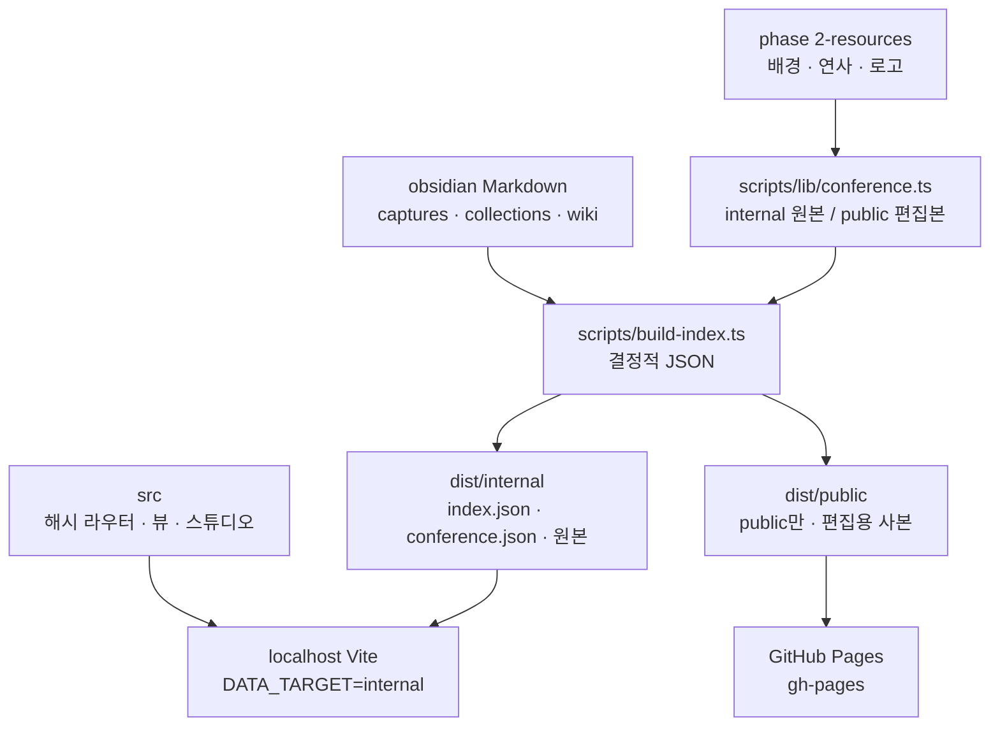
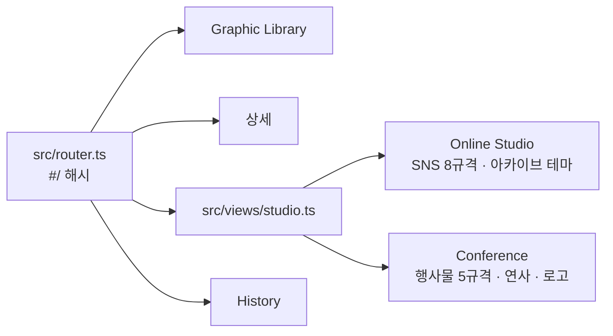

# Development note

AX Design Studio를 어떤 언어와 로직으로, 어떤 구조로 만들었는지 적는다. 다음에 비슷한 툴을 만들 때 이 뼈대를 다시 쓴다. 화면 원칙은 [`woongdesignv3.md`](woongdesignv3.md), 결정 문장은 [`docs/decisions.md`](docs/decisions.md)에 있다.

## 언어와 런타임

| 층 | 언어·도구 | 하는 일 |
|---|---|---|
| UI | TypeScript, CSS | 프레임워크 없이 DOM을 직접 그린다 |
| 빌드 UI | Vite 6, `tsc --noEmit` | `src/`를 `dist/app`으로 묶는다 |
| 데이터 빌드 | TypeScript, `tsx`, Node | Markdown을 JSON으로 굽는다 |
| 이미지 | `sharp` | 크기·썸네일·공개용 JPEG |
| 동영상 | `ffmpeg` / `ffprobe` | 공개용 MP4를 줄이고, 길이를 읽는다 |
| 저장소 | Obsidian Markdown, JSON | 사람이 읽는 원본과 웹이 읽는 결과 |
| 배포 | 정적 파일, GitHub Pages | 서버 없음. `gh-pages` 브랜치에 수동 배포 |

React, Vue, 라우터 라이브러리, 검색 라이브러리, CSS 프레임워크는 쓰지 않는다. 패키지 이름은 예전 저장소 이름 `design-llm-wiki`가 남아 있다.

## 로직

세 층으로 나뉜다.

1. **Vault가 진실이다.** `obsidian/captures/<slug>/index.md`와 같은 폴더의 이미지가 아카이브다. 컬렉션과 위키도 Markdown이다. 치수, 바이트, 해시, 재생 시간은 Markdown에 적지 않고 빌드가 파일에서 계산한다.
2. **빌드가 두 벌의 사이트를 만든다.** `internal`은 로컬 호스트용 전체다. `public`은 `visibility: public`만 담고, internal 항목은 가리지 않고 빼 둔다. Conference 원본은 internal에 두고, public에는 편집 크기 JPEG와 긴 변 1920 MP4를 넣는다.
3. **브라우저는 결과만 읽는다.** `dist/<target>/data/index.json`과 복사된 자산만 fetch한다. Markdown과 LLM 키는 브라우저에 없다. 카드 합성, PNG, 인쇄용 PNG, MP4는 브라우저 안에서 만든다. 만든 카드는 vault에 저장하지 않고 그 브라우저의 `localStorage`에만 남는다.

사람이 `npm run build`, `npm run build:site`, 배포를 실행한다. 파일 감시나 GitHub Actions 자동 배포는 없다.

## 구조도



앱 안의 화면은 라우터 하나에서 갈라지고, 편집기는 설정만 다른 한 벌이다.



`conference.json`이 없으면 `#/conference`는 Online Studio로 보낸다. public 번들에 그 파일이 있어야 라이브 네비에 Conference가 나온다.

## 디렉터리

```text
obsidian/                 Markdown 원본
src/main.ts               셸, 데이터 로드, 라우트별 화면
src/router.ts             해시 경로
src/views/                archive, capture, studio, history
src/shared/tokens.css     UI 색 hex의 유일한 곳
src/shared/studio.ts      카드 상태, 레이어, 폰트
src/shared/studio-shapes.ts  도형 · 선 · 펜 · 그라데이션
src/shared/conference.ts  행사물 프리셋과 conference.json 계약
src/shared/print-png.ts   인쇄용 PNG 인코더
src/styles/base.css       크롬. var(--*)만 사용
scripts/build-index.ts    vault → JSON
scripts/lib/conference.ts 리소스 복사와 공개용 축소
scripts/check-*.ts        hex, 대비, 접근성, public 누출
phase 2-resources/        Conference 원본. 웹은 직접 읽지 않음
```

## 특별한 코드

**편집기 한 벌.** `renderStudio`와 `mountStudio`가 `StudioConfig`를 받는다. 프리셋 목록, 배경, 리소스 묶음, 내보내기, 초기화 키가 설정이다. Online Studio와 Conference는 `StudioState`를 따로 갖고, 탭을 오가도 카드를 덮어쓰지 않는다. 초기화 기준도 `ax-studio-baselines`와 `ax-conference-baselines`로 나뉜다.

**레이어.** 카드는 배경 위에 글자, 이미지, 도형, 선, 펜이 쌓인 목록이다. Shift로 여러 개를 고르고, 정렬·복제·순서·크롭·실행 취소를 한 모델에서 처리한다. 도형은 한 번 누르면 크기와 radius, 두 번 누르면 점의 위치와 휘어짐이다.

**인쇄용 PNG.** X배너 3543×10630, L배너 21260×3543은 한 캔버스에 들어가지 않는다. `src/shared/print-png.ts`가 `CompressionStream`으로 가로 띠를 나눠 PNG를 만들고, pHYs 청크에 dpi를 넣는다. Safari 캔버스 한도에 맞추려고 한 띠의 픽셀 수를 제한한다.

**동영상 내보내기.** 배경이 동영상이면 `MediaRecorder`로 글자와 도형이 올라간 MP4를 받는다. 길이는 원본 한 바퀴인 약 5.04초다. 브라우저 인코더가 편집 크기를 거부하면 더 작은 변으로 다시 시도한다. MP4를 못 만드는 브라우저에서는 버튼을 끈다.

**공개용 축소.** `buildConference(outRoot, "web")`가 배경 PNG를 편집 크기 JPEG로, MP4를 긴 변 1920·CRF 28로 만든다. `"original"`은 100MB 이하 원본을 복사한다. 123MB Slide 원본은 `.gitignore`에 있고 빌드가 건너뛴다. 원본을 그대로 Pages에 넣으면 배포가 실패했다.

**결정적 JSON.** `stableStringify`로 키 순서를 고정한다. 같은 Markdown과 같은 리소스면 `index.json`과 `conference.json`이 바이트 단위로 다시 나온다.

**색 검사.** `scripts/check-hex.ts`는 `src/shared/tokens.css` 밖의 UI hex를 실패시킨다. `scripts/check-contrast.ts`는 선언한 글자·배경 쌍의 대비를 본다. 캡처 분석에 적힌 외부 제품 색은 데이터가 아니라서 이 검사의 대상이 아니다.

**모노 로고.** 다크 모드 리소스 칸에서만, 색이 없고 어두운 SVG에 `invert(1)`을 준다. 판별은 48px 캔버스 샘플이다. 카드에 그린 로고는 파일 색이고, 레이어의 `tint`가 있을 때만 `source-in`으로 단색이 된다.

## 화면이 데이터를 읽는 방식

Vite `publicDir`은 `dist/internal` 또는 `dist/public`이다. 개발 서버는 환경변수 없이 internal을 연다. 공개 사이트 빌드는 `DATA_TARGET=public`으로 UI를 묶고, 그 산출물을 `gh-pages`에 올린다.

History는 `obsidian/wiki/log.md`의 `update` 항목만 공개 번들에 들어간다. `ingest`, `query`, `lint`는 internal에만 남는다.

## 같은 툴을 다시 만들 때

- UI는 작은 TypeScript 뷰로 유지하고, 편집 상태는 한 모듈에 둔다.
- 두 번째 편집 화면이 필요하면 컴포넌트를 복제하지 않고 설정 객체를 추가한다.
- 원본 파일과 공개 파일을 빌드 타깃에서 가른다. 공개 한도는 용량과 배포 시간이다. 이 저장소의 기준은 Pages 1GB, 파일 100MB, 배포 약 10분이다.
- 색과 대비 검사를 빌드에 넣는다. 문서로만 적으면 다음 화면에서 어긋난다.
