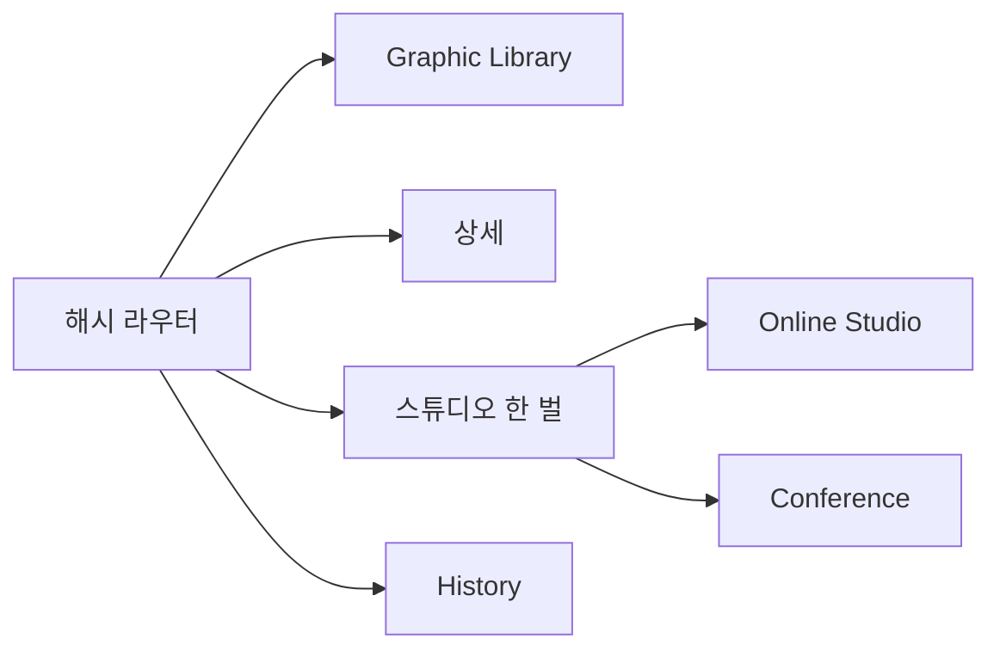

# Phase 0 — Archive Foundation (기존 Phase 0~8 통합)

목표: 디자인 이미지를 Obsidian vault에 아카이빙하고, 빌드된 JSON만 읽는 정적 웹에서 탐색하는 기반을 만든다. Phase 1 Online Studio는 이 기반 위에서 아카이브 이미지를 소재로 쓴다.

참조 결정: `D-01`~`D-17` ([decisions.md](decisions.md))

> 상태: **완료(유지보수 대상)**. 이 문서는 예전 `phase-0-foundation` ~ `phase-8-marketing-image-generation` 9개 문서를 한 문서로 요약한 것이다. 세부 원문은 Git 이력에 남아 있다.

## 통합 전후 대응

| 예전 Phase | 주제 | 현재 상태 |
|---|---|---|
| 0 Foundation | 토큰 단일 원천, 대비 검증, focus-visible, coarse pointer 터치 타깃, LF 정규화 | 완료 |
| 1 Schema | Markdown 스키마, vault 구조, 통제 어휘, visibility, LLM Wiki index/log | 완료 |
| 2 Build | 결정적 JSON, 자산 프로브, 태그 정규화, 중복 감지, internal/public 이중 번들, 빌드 리포트 | 완료 |
| 3 Gallery | 앱 셸, 해시 라우터, Archive 그리드, 검색·필터, 다크 모드, 키보드 접근 | 완료 |
| 4 Features | 상세 뷰, 통계 | 축소 완료. Collections·Wiki·Export 화면과 Related captures는 제품 UI에서 제거했다. |
| 5 A11y/Deploy | 대비·키보드·터치 감사, public 누출 점검, Pages 용량, 수동 배포 | 완료 |
| 6 Intake/Ingest | 로컬 `npm run ingest`로 vault 영구 저장 + LLM 분석 초안 | CLI 구현. Intake 탭은 Phase 1에서 제거 예정 |
| 7 Design System | `npm run design-system`으로 `design-system.md`·`tokens.json` 초안 생성 | CLI 구현. Design System 탭은 Phase 1에서 제거 예정 |
| 8 Marketing Image | 디자인 시스템 기반 마케팅 이미지 생성 | 계획만 있었고, Phase 1 Online Studio로 대체 |

## 핵심 계약

- **단일 원천**: `obsidian/` Markdown이 진실이다. 웹은 `dist/<target>/data/index.json`과 복사된 자산만 읽는다. (`D-01`)
- **vault 구조**: `obsidian/captures/<slug>/index.md` + 같은 폴더 원본 자산, `obsidian/collections/*.md`, `obsidian/wiki/{index,log}.md`와 `patterns/services/comparisons/questions`. (`D-05`, `D-16`)
- **공유 모듈**: `src/shared/schema.ts`, `vocabulary.ts`, `filter.ts`, `frontmatter.ts`를 빌드와 UI가 함께 쓴다.
- **파생 메타 금지**: 치수·바이트·포맷·프레임 수·재생 시간·해시는 Markdown에 쓰지 않고 빌드가 파일에서 계산한다.
- **이중 번들**: `internal`은 전체, `public`은 `visibility: public`만 포함한다. public에는 internal 데이터와 자산을 복사하지 않는다. (`D-03`)
- **사람이 실행**: ingest, 빌드, 배포는 사람이 명령으로 실행한다. watcher·CI 자동 배포는 만들지 않는다. 브라우저는 LLM 키를 갖지 않는다. (`D-10`, `D-11`)
- **토큰**: UI 색상 hex는 `src/shared/tokens.css`에만 둔다. Cool Blue 고정, light/dark 모드만 전환한다. (`D-12`, `D-14`)

## 디자인 시스템 v3

전문은 [woongdesignv3.md](../woongdesignv3.md)다. 강의용 [woongdesignv2.md](../woongdesignv2.md)의 색·서체·컴포넌트 표를 그 문서 안에 함께 정리했다. 이 제품에서 고정한 원칙은 아래다.

1. 도구 화면이므로 Cool Blue 한 세트만 쓴다. `data-theme="cool"`, `data-mode`는 light 또는 dark. Warm·Mint·Violet 전환 UI는 없다.
2. 크롬과 작품을 나눈다. 네비·패널은 활자, 색면, 0.5px 선만 쓴다. 카드 안의 그림자·그라데이션·도형·펜은 사용자가 내보내는 작품이다.
3. 바닥은 `#FCFCFF` / `#010102`, Primary는 `#4065F8`, 카드 기본 radius는 28px, 네비 높이는 80px다. 크롬 서체는 Pretendard 20px다.
4. Samsung Sharp Sans는 v2 디스플레이 서체로 남아 있고, 라이선스 확인 전까지 이 제품 공개 번들에는 넣지 않는다.
5. v2의 muted 60%·stroke 40%는 대비가 부족해 제품에서 0.82·0.72로 올렸다. hex는 `src/shared/tokens.css` 밖에 두지 않는다.

## 개발 구조

전문과 구조도는 [development-note.md](../development-note.md)에 있다. UI는 프레임워크 없는 TypeScript와 CSS이고, Vite 6이 묶는다. Node 스크립트가 Obsidian Markdown을 `dist/<target>/data/index.json`으로 굽는다. 브라우저는 그 JSON과 복사된 자산만 읽는다.



Online Studio와 Conference는 `src/views/studio.ts` 하나를 `StudioConfig`로 나눈다. 인쇄용 PNG는 `src/shared/print-png.ts`가 `CompressionStream`으로 띠를 나눠 만든다. 동영상 내보내기는 브라우저 `MediaRecorder`다. Conference 공개 파일과 로컬 호스트는 `scripts/lib/conference.ts`가 100MB 이하 원본을 복사한다.

## 현재 제품 상태

- 브랜드: 헤더 타이틀 **AX DESIGN STUDIO**.
- 네비: Graphic Library / Online Studio / Conference / History. `#/intake`, `#/design-system`, `#/stats`는 `#/studio`로 이동한다. `conference.json`이 없으면 `#/conference`도 `#/studio`로 보낸다.
- Archive: All/Pin 탭 + 1:1 카드 그리드(이미지 cover 채움). 검색창과 필터 패널은 없다. 카드 kind 뱃지는 motion만 표시.
- 상세 뷰: 왼쪽 Back 버튼, 이미지 contain + 남는 영역 light 흰색 / dark 검정(`--media-matte`), 분석 본문과 `Graphic asset` 설명.
- 데이터: `image-pick-hermes` 그래픽 에셋 스터디 35건(모두 public). 사이트에 쓰는 PNG는 3072 정사각이고, 4K 원본은 `image-pic-high-resolution`에 둔다. 더미 캡처는 삭제했다.

## 명령

```bash
npm run validate
npm run build -- --target=internal|public
npm run build:site -- --target=internal|public
npm run audit
npm run ingest -- <image>          # OPENAI_API_KEY 필요
npm run design-system -- --name <name> --slugs <slug...>
npm run dev
```

`npm run seed:dummy`는 현재 Hermes 아카이브를 더미 데이터로 덮어쓴다.

## 통과 기준 (유지)

- `npm run audit` exit 0: hex 단일 원천, 대비, a11y CSS, internal/public 빌드, public 누출 0건, 필터·Phase4 테스트, UI 빌드.
- 같은 입력에서 `index.json`이 바이트 단위로 재현된다.

## 남은 확인 필요

| 항목 | 이유 |
|---|---|
| Samsung Sharp Sans 재배포 | public 번들과 Phase 1 다운로드 이미지에 폰트를 쓸 수 있는지 라이선스 확인이 필요하다. |
| `ffmpeg`/`ffprobe` 의존 | 모션 캡처 프로브·포스터 실검증이 남아 있다. |
| `dist/` 커밋 정책 | 현재는 `.gitignore` 대상이고 Pages는 `gh-pages` 브랜치로 수동 배포했다. |
