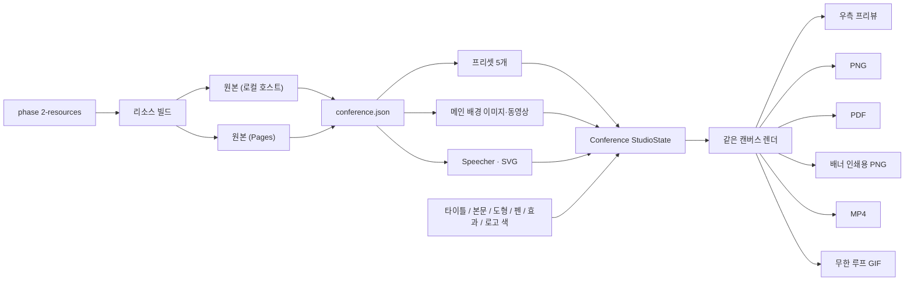

# Phase 2 — Conference

목표: 컨퍼런스 행사물(인스타그램, 포스터, 슬라이드, 배너)을 만드는 **Conference** 탭을 추가한다. 편집 인터페이스는 Online Studio와 같고, 카드 크기와 쓰는 이미지만 다르다.

참조 결정: `D-01`, `D-03`, `D-09`, `D-11`, `D-12`, `D-15` / 기반: [Phase 0 Archive Foundation](phase-0-foundation.md), [Phase 1 Online Studio](phase-1-online-marketing-studio.md)

> 상태: **구현**. 2026-10-17에 2-1부터 2-12를 로컬 호스트에 넣었다. 2026-10-20에 연사 사진과 로고 공개를 허락하고 GitHub Pages에도 Conference를 열었다. 2026-10-25에 배경을 `[Graphic_Resources] 2`로 바꾸고, 연사별 인스타그램 카드·PDF·무한 루프 GIF와 공유 편집 기능을 더했다. 같은 날 저장해 둔 인스타그램·포스터·슬라이드·X배너·L배너 레이아웃을 기본값으로 넣었고, 공개 사이트도 100MB 이하 원본 배경을 쓴다(`D-09`). 2026-10-27에 포스터·슬라이드·X배너·L배너 레이아웃을 다시 맞추고, 배경 동영상을 color MP4로 바꿨다. 포스터 동영상은 2880 × 3840이다. 정한 사항은 맨 아래 [결정 기록](#결정-기록)에 있다.

## 범위

- 입력: 저장소 루트 `phase 2-resources/`의 세 폴더. 브라우저는 이 폴더를 직접 읽지 않고, 빌드가 만든 JSON과 복사한 자산만 읽는다. (`D-01`)
- 출력: 행사물 크기의 PNG와 PDF, 배너의 인쇄 해상도 PNG, 동영상 배경일 때 글자·도형이 올라간 MP4와 무한 반복 GIF.
- 서버·LLM 호출 없음. 합성과 내보내기는 브라우저 안에서 일어난다. (`D-11`)
- 공개 범위: internal과 public 번들 모두에서 연다. 둘 다 100MB 이하 원본 배경을 쓴다. (`D-09`)
- Online Studio의 기능은 그대로 쓴다. Phase 1의 1-2부터 1-14까지(레이어, 선택, 정렬, 글자 스타일, 스포이드, 크롭, 도형·선·펜, 표면 효과, 점 편집)가 Conference에도 똑같이 있다.

## Online Studio와 다른 점

| 항목 | Online Studio | Conference |
|---|---|---|
| 주소 | `#/studio` | `#/conference` |
| 카드 크기 프리셋 | SNS 8개 규격 | 행사물 5개 규격(Instagram, Poster, Slide, X배너, L배너) |
| 배경 | 아카이브 테마 35개 중 하나를 이미지 레이어로 | 프리셋마다 정해진 메인 배경. 이미지와 동영상을 바꿔 쓸 수 있다 |
| 이미지 목록 | 아카이브 테마 + 추가한 이미지 | Speecher, SVG 두 묶음 + 추가한 이미지 |
| 내보내기 | PNG, PDF | PNG, PDF, 배너 인쇄용 PNG, 동영상, 무한 루프 GIF |
| 초기화 기준 저장 | `ax-studio-baselines` | Conference 전용 키. 인스타그램은 연사 카드마다 따로 저장한다. 두 탭의 기준이 섞이지 않는다 |

## 리소스 현황

`phase 2-resources/`는 세 폴더다. 아카이브 테마 자리에 이 세 묶음이 들어간다. 2026-10-25부터 배경 빌드는 `[Graphic_Resources] 2`만 읽는다. 정지 이미지는 `.png`, `.jpg`, `.jpeg`다.

| 폴더 | 내용 | 쓰임 |
|---|---|---|
| `[Graphic_Resources] 2` | 하위 폴더 4개. 같은 블루·피치 그라데이션의 정지 이미지와, L배너를 뺀 5초 동영상 | 카드 크기 프리셋과 메인 배경 |
| `[SVG]` | 로고와 QR 12개. 모두 1080 × 1080 viewBox | 카드 위에 올리는 로고 레이어 |
| `[Speecher]` | 연사 사진 4장. 배경이 투명한 PNG | 카드 위에 올리는 인물 레이어 |

### Graphic Resources 2 실측

| 폴더 | 정지 이미지 | 동영상 | 메모 |
|---|---|---|---|
| `01_Instagram` | 2160 × 2160 PNG, 2.4MB | 2160 × 2160 H.264, 5.04초, 8.2MB | 이미지와 동영상 크기가 같다. |
| `02_Poster` | 2880 × 3840 PNG(3:4), 5.7MB | 2880 × 3840 H.264, 5.04초, 22MB | 이미지와 동영상 크기가 같다. |
| `03_Slide` | 3840 × 2160 PNG(16:9), 4.3MB | 3840 × 2160 H.264, 5.04초, 16MB | 100MB 한도 안에 있어 원본을 커밋한다. |
| `04_Banner` | X배너 2666 × 8000 JPEG, 2.2MB / L배너 21260 × 3543 PNG(5400 × 900mm, 100dpi), 36MB | X배너 2160 × 6468 H.264, 5.04초, 30MB | 동영상은 X배너만 있다. 파일명과 실측이 같다. |

- 동영상 4개는 모두 길이가 같아 반복 재생하면 같은 리듬으로 움직인다. L배너에는 동영상이 없다.
- X배너 인쇄용 PNG 목표 크기는 정지 이미지와 별도로 3543 × 10630, 150dpi다. L배너는 21260 × 3543, 100dpi다.
- Speecher는 001이 2379 × 3114, 002가 2568 × 3114, 003이 2684 × 3200, 004가 2420 × 3200이다.
- SVG는 파일당 4~32KB다. 파일명에 한글과 공백이 있어 빌드에서 영문 slug로 바꾼다.
- 파일명 크기와 실측이 다르면 실측을 쓴다.
- 이전 `[Graphic_Resources]`의 Slide 원본 동영상(123MB)은 계속 `.gitignore`에 있다. 빌드는 그 폴더를 읽지 않는다.

## 카드 크기 프리셋

대표 이미지 비율을 그대로 쓴다. 편집 크기는 스튜디오의 너비·높이 한도(100~4000px)와 브라우저 캔버스 한도 안에 들어가게 정하고, 배너는 인쇄 크기로 따로 내보낸다.

| id | 이름 | 대표 이미지 | 편집·PNG 크기(px) | 인쇄용 PNG | 비율 | 동영상 배경 |
|---|---|---|---|---|---|---|
| `conf-instagram` | Instagram | 2160 × 2160 | 2160 × 2160 | — | 1:1 | 있음 |
| `conf-poster` | Poster | 2880 × 3840 | 2880 × 3840 | — | 3:4 | 있음 |
| `conf-slide` | Slide | 3840 × 2160 | 3840 × 2160 | — | 16:9 | 있음 |
| `conf-banner-x` | X배너 | 2666 × 8000 JPEG | 1280 × 3840 | 3543 × 10630 (600 × 1800mm, 150dpi) | 1:3 | 있음 |
| `conf-banner-l` | L배너 | 21260 × 3543 | 3840 × 640 | 21260 × 3543 (5400 × 900mm, 100dpi) | 6:1 | 없음 |

- 처음 열면 Instagram이 선택된다.
- X배너와 L배너 원본은 4000px 한도와 Safari 캔버스 넓이 한도(약 1,677만 화소)를 넘는다. 그래서 같은 비율의 작은 크기로 편집하고, 인쇄용 PNG는 2-7의 방식으로 따로 만든다.
- L배너는 동영상이 없어 배경 전환에서 `동영상`이 꺼져 있고, 동영상 내보내기도 없다.
- 프리셋 칸에는 Phase 1처럼 그 규격을 실제 비율로 줄인 썸네일을 둔다. 썸네일은 대표 이미지에서 만든다.

## 화면 레이아웃

```text
┌──────────────────────────── AX DESIGN STUDIO ─────────────────────────────┐
│ Graphic Library · Online Studio · Conference · History                     │
├──────────────────────────────────────────────────────────────────────────┤
│ Control panel (좌)          ┃ Preview (우)                               │
│ ┌ [Design] [Code] 탭 ─────┐ ┃                                            │
│ │ 카드 크기 프리셋 (5)     │ ┃      ┌──────────────────┐                  │
│ │ 배경  [이미지] [동영상]  │ ┃      │  메인 배경 위의   │                  │
│ │ 도형 / 선 / 펜           │ ┃      │  카드 프리뷰      │                  │
│ │ 너비 / 높이 (바 + 수치)  │ ┃      │  (실제 비율)      │                  │
│ │ 타이틀 / 본문 + 폰트 크기│ ┃      └──────────────────┘                  │
│ │ 폰트                     │ ┃   ▶︎ / ❚❚ (동영상 배경일 때)               │
│ │ 리소스                   │ ┃                                            │
│ │  ├ Speecher (4)          │ ┃  1280 × 3840 · X배너                       │
│ │  └ SVG (12) + 로고 색    │ ┃  [PNG] [PDF] [인쇄용 PNG] [동영상] [GIF]   │
│ │ 이미지 크기              │ ┃                                            │
│ │ 컬러 / radius            │ ┃                                            │
│ └─────────────────────────┘ ┃                                            │
└────────────── 드래그 분할 바 ┃────────────────────────────────────────────┘
```

Online Studio의 패널 순서를 그대로 쓰고, `아카이브 테마` 자리를 `배경`과 `리소스`로 바꾼다. 다운로드 버튼은 지금 프리셋과 배경에서 쓸 수 있는 것만 보인다.

## 개발 순서

| 단계 | 내용 | 상태 |
|---|---|---|
| 2-1 | 네비에 Conference를 추가하고 `#/conference`로 들어온다 | 구현 |
| 2-2 | 스튜디오 화면을 설정값으로 받아 두 탭이 같은 코드를 쓰게 나눈다 | 구현 |
| 2-3 | 리소스 빌드: 원본을 로컬 호스트에서 쓴다. 웹용 사본은 공개 허락 뒤에 만든다 | 구현 |
| 2-4 | 카드 크기 프리셋 5개와 썸네일 | 구현 |
| 2-5 | 메인 배경 레이어와 이미지·동영상 전환 | 구현 |
| 2-6 | 동영상 배경의 프리뷰와 프레임 PNG | 구현 |
| 2-7 | 배너 인쇄용 PNG | 구현 |
| 2-8 | 동영상 내보내기 | 구현 |
| 2-9 | Speecher와 SVG 넣기, 로고 색 바꾸기 | 구현 |
| 2-10 | Conference 전용 초기화 기준과 내장 기준 | 구현 |
| 2-11 | 저장소 용량과 Pages 1GB 점검 | 구현 |
| 2-12 | 테스트와 문서 | 구현 |

### 2-1 정보 구조

계획: 네비를 Graphic Library / Online Studio / Conference / History로 바꾼다. `#/conference`가 Conference 진입점이다. Online Studio와 같은 디바이스 뷰 바와 좌우 분할 레이아웃을 쓴다. `conference.json`이 없으면 `#/conference`는 Online Studio로 보낸다.

검증: 로컬 호스트와 public 번들에서 네비에 네 탭이 보이고, Conference를 누르면 Instagram 프리셋과 메인 배경이 깔린 카드가 열린다. `#/studio`는 지금과 똑같이 열린다.

### 2-2 같은 편집기, 다른 설정

계획: `renderStudio`와 `mountStudio`가 탭 설정을 받게 한다. 설정에는 프리셋 목록, 배경 목록, 리소스 묶음, 내보내기 종류, 초기화 기준 저장 키, 다운로드 파일명 접두어가 들어간다. 편집 기능(레이어, 선택, 도형, 펜, 효과, 단축키, 되돌리기)은 한 벌만 두고 두 탭이 같이 쓴다. Online Studio와 Conference는 각자 `StudioState`를 갖고, 탭을 오가도 서로의 카드를 덮지 않는다.

검증: Online Studio의 기존 테스트(`npm run test:studio`)가 그대로 통과한다. 한 탭에서 만든 도형이 다른 탭에 나타나지 않는다. Conference에서 Phase 1의 도형·펜·점 편집이 똑같이 동작한다.

### 2-3 리소스 빌드

계획: `phase 2-resources/`는 사람이 넣는 원본 폴더다. 빌드가 파일을 열어 실제 크기·길이·바이트를 계산하고(Phase 0의 파생 메타 원칙), 로컬과 공개 사이트에 같은 원본을 복사한다.

| 벌 | 쓰는 곳 | 내용 |
|---|---|---|
| 원본 | internal·public 빌드, 로컬 호스트, GitHub Pages | `[Graphic_Resources] 2`의 PNG·JPEG·동영상과 SVG를 그대로 복사한다. Slide 동영상은 16MB라 줄이지 않는다. 인쇄용 PNG는 이 원본 배경으로 그린다. 프리셋·리소스 썸네일도 이때 만든다. |

- 로컬 호스트와 공개 사이트 모두 100MB 이하 원본을 읽는다. ffprobe가 없으면 동영상 크기·길이를 비워 두고 리포트에 경고를 남긴다. (`D-11`)
- 폴더·파일 이름은 `instagram`, `poster`, `slide`, `banner-x`, `banner-l`, `speaker-001`, `logo-brunel-1`처럼 영문 slug로 바꾼다. 이름표는 한국어로 보여 준다.
- 목록은 별도 `conference.json`으로 둔다. internal과 public은 같은 항목과 같은 파일 크기를 만든다. 같은 입력·같은 타깃이면 바이트 단위로 같은 결과가 나와야 한다.
검증: 빌드 리포트에 리소스 개수, 바이트, 실측 크기가 나온다. Poster·X배너 동영상은 실측 크기로 적힌다. 100MB를 넘는 리소스 파일이 있으면 리포트에 표시된다.

### 2-4 카드 크기 프리셋

계획: 위 표의 5개 프리셋을 `studio-presets.ts`와 같은 형태의 데이터 한 곳에 둔다. 편집 크기, 인쇄 크기, dpi, 동영상 유무를 함께 적는다. UI 목록, 프리뷰, 다운로드가 같은 배열을 쓴다. 프리셋을 누르면 카드 크기와 메인 배경이 함께 바뀐다. 너비·높이 바로 직접 크기를 바꾸면 배경은 카드를 가득 채우도록 잘려 보인다.

검증: 처음 열면 2160 × 2160 Instagram이다. 다섯 프리셋을 누를 때마다 크기와 배경이 그 폴더 것으로 바뀐다. X배너는 1280 × 3840, L배너는 3840 × 640이다.

### 2-5 메인 배경

계획: 배경은 맨 아래에 고정된 배경 레이어로 둔다. 일반 이미지 레이어와 달리 카드를 항상 가득 채우고, 옮기거나 지울 수 없다. 패널의 `배경`에서는 지금 프리셋 폴더의 `이미지`와 `동영상`만 바꾼다. 다른 폴더 배경은 고르지 않는다. 동영상이 없는 L배너에서는 `동영상`이 꺼져 있다.

배경을 바꾸는 것도 되돌리기 한 단계다. 배경 위에는 Phase 1의 카드 컬러, radius, 이미지 레이어, 도형이 그대로 올라간다.

검증: 이미지와 동영상을 바꿔도 위의 글자·도형 위치가 그대로다. L배너에서는 `동영상`을 누를 수 없다. 배경 레이어는 오른쪽 클릭 메뉴의 삭제·맨 위로 보내기 대상이 아니다.

### 2-6 동영상 배경 프리뷰

계획: 동영상은 소리 없이 반복 재생하고, 프리뷰 캔버스는 재생 중인 프레임을 매 화면 갱신마다 그린다. 동영상을 쓰는 동안만 그리기 루프를 켜고, 이미지로 바꾸거나 탭을 떠나면 끈다.

- 프리뷰 아래에 재생·일시정지 버튼을 둔다. `PNG`는 지금 보이는 프레임을 그린다.
- 동영상을 아직 불러오지 못했으면 포스터 이미지를 그리고, Phase 1처럼 프리뷰 가운데에 로딩 문구를 보인다.
- 코드 내보내기: 배경을 `<video autoplay muted loop playsinline>`과 포스터로 낸다.

검증: 동영상 배경 위에서 글자를 끌어도 끊기지 않는다. 일시정지한 프레임이 PNG에 그대로 나온다. 탭을 떠나면 재생과 그리기 루프가 멈춘다.

### 2-7 배너 인쇄용 PNG

계획: X배너와 L배너에 `인쇄용 PNG`를 둔다. 결과는 프리셋에 적힌 인쇄 크기다(X배너 3543 × 10630 150dpi, L배너 21260 × 3543 100dpi). X배너 정지 이미지 파일은 2666 × 8000 JPEG이고, 인쇄용 PNG는 그 파일 크기와 별도다.

- 한 장의 캔버스로는 그릴 수 없다. 편집 좌표를 인쇄 크기 비율(X배너 약 2.77배, L배너 약 5.54배)로 키워, 카드를 가로 띠 여러 개로 나눠 차례로 그린다.
- 각 띠의 화소를 행 단위로 PNG 파일에 이어 쓴다. 브라우저 내장 `CompressionStream`으로 압축하고, PNG 헤더에 dpi(150, 100)를 적는다.
- 배경은 원본 PNG에서 띠 높이만큼 잘라 그린다. 글자·도형·SVG는 벡터라 인쇄 크기에서 다시 그리고, Speecher 같은 비트맵은 원본 해상도까지만 선명하다.
- 동영상 배경을 쓰고 있어도 인쇄용 PNG는 정지 이미지 배경으로 그린다.
- L배너 결과는 화소 약 7,500만 개다. 만드는 동안 진행률을 보이고, 취소할 수 있게 한다.

검증: 결과 PNG의 크기와 dpi가 위 표와 같다. 편집 화면과 같은 위치에 글자·도형이 있다. 띠 경계에 이음선이 보이지 않는다. Chrome과 Safari에서 L배너 인쇄용 PNG가 끝까지 만들어진다.

### 2-8 동영상 내보내기

계획: 동영상 배경일 때 `동영상` 버튼으로 글자·도형·리소스가 올라간 동영상 파일을 받는다.

- 배경 동영상을 처음부터 한 바퀴(5.04초) 재생하면서 합성 캔버스를 `captureStream`과 `MediaRecorder`로 녹화한다. 소리는 없다.
- 형식은 MP4(H.264)만이다. 브라우저가 MP4 녹화를 지원하지 않으면 `동영상` 버튼을 끄고, 최신 Chrome이나 Safari를 쓰라는 안내를 보인다. WebM으로는 받지 않는다.
- 출력 크기는 편집 크기를 먼저 시도한다. 브라우저 인코더가 그 크기를 지원하지 않으면 아래의 줄인 크기로 녹화하고, 줄였다는 사실을 다운로드 옆에 알린다.

| 프리셋 | 먼저 시도 | 지원하지 않을 때 |
|---|---|---|
| Instagram | 2160 × 2160 | 1920 × 1920 |
| Poster | 2880 × 3840 | 2160 × 2880 |
| Slide | 3840 × 2160 | 1920 × 1080 |
| X배너 | 1280 × 3840 | 960 × 2880 |

- 지원 여부는 녹화 전에 `VideoEncoder.isConfigSupported`로 확인한다. 확인하고도 녹화가 실패하면 한 번만 줄인 크기로 다시 시도한다.
- 녹화하는 동안 편집을 잠그고 진행률을 보인다.
- `[Graphic_Resources] 2`의 동영상으로 녹화한다. Slide는 16MB 원본이다.

검증: 받은 파일이 5초 남짓이고, 편집 화면과 같은 위치에 레이어가 있다. 끝 프레임과 첫 프레임이 이어져 반복 재생이 자연스럽다. 받은 MP4가 macOS QuickTime에서 열린다. MP4 녹화를 지원하지 않는 브라우저에서는 `동영상` 버튼이 꺼져 있고 안내가 보인다.

### 2-9 Speecher와 SVG

계획: 아카이브 테마 자리에 `Speecher`와 `SVG` 두 묶음을 둔다. Phase 1의 테마 썸네일처럼 누르거나 프리뷰로 끌어다 놓으면 새 이미지 레이어로 들어간다.

- Speecher는 투명 배경을 그대로 살려 메인 배경 위에 인물만 올라간다. 처음 크기는 카드 높이의 절반쯤으로 둔다.
- SVG는 카드 너비의 1/4쯤으로 들어가고, 벡터라 크게 키워도 선명하다. 캔버스에는 지금 레이어 크기에 맞춰 다시 그린다.
- 로고 색: SVG 레이어를 선택하면 `로고 색`이 보인다. `원래 색`과 단색 하나를 고를 수 있고, 단색은 Phase 1의 컬러 입력·스포이드와 같은 방식으로 정한다. 단색을 고르면 SVG 안의 채움·선 색을 모두 그 색으로 바꿔 그린다. 원본 SVG 파일은 바꾸지 않고, 레이어에 고른 색만 저장한다.
- `+`로 넣는 추가 이미지는 Online Studio와 같이 그 브라우저에만 저장한다.

검증: 연사 사진 가장자리에 흰 테두리가 남지 않는다. SVG를 4000px까지 키워도 계단이 생기지 않는다. 로고를 흰색으로 바꿨다가 `원래 색`으로 돌리면 원본과 같다. PNG·인쇄용 PNG·동영상에 바꾼 로고 색이 그대로 나온다.

### 2-10 초기화 기준

계획: Phase 1의 1-9·1-11과 같은 방식이다. `초기화로 세팅`은 지금 레이아웃을 그 프리셋의 기준으로 Conference 전용 키에 저장한다. 저장한 것이 없으면 앱에 내장한 Conference 기준(5개 프리셋)을 쓴다. 설정 메뉴의 리셋은 두 탭의 저장한 기준을 모두 지운다.

검증: Conference에서 세팅한 기준이 Online Studio의 초기화에 영향을 주지 않는다. 리셋하면 두 탭 모두 내장 기준으로 돌아간다.

### 2-11 저장소 용량과 Pages 배포

계획:

- 원본 리소스는 저장소에 커밋한다. 단, Git 단일 파일 한도(100MB)를 넘는 Slide 동영상(123MB)은 원본을 `.gitignore`에 적고, ffmpeg로 줄인 사본을 대신 커밋한다. (`D-15`)
- Slide 사본은 3840 × 2160과 5.04초 길이를 지키고, 화질을 보며 100MB보다 넉넉히 작게(목표 60MB 안쪽) 줄인다.
- 커밋하는 리소스는 원본 약 216MB에 Slide 사본을 더한 크기다. 리포 권장 크기 1GB 안에 드는지 커밋 전에 저장소 크기를 확인한다.
- public 빌드도 `conference.json`을 만든다. 2026-10-25부터 배경도 100MB 이하 원본을 복사한다. 이전 세트는 원본이 커서 Pages 배포가 실패해 편집용으로 줄였다. 아카이브 자산과 Conference를 합친 바이트가 Pages 1GB를 넘으면 빌드가 실패한다.
- `npm run check:public-leak`는 internal 캡처가 public에 새지 않는지만 본다. Conference는 public에 있어도 통과한다.

검증: `npm run build:site -- --target=public` 결과에 `data/conference.json`과 `assets/conference/`가 있고, `npm run check:public-leak`가 통과한다. 100MB를 넘는 파일이 없다. 이전 폴더의 Slide 123MB만 `.gitignore`에 있고, `[Graphic_Resources] 2`의 Slide 16MB는 커밋한다.

### 2-12 테스트와 문서

계획: 프리셋 데이터, 배경 전환과 동영상 없는 프리셋, 배경 레이어가 지워지지 않는 규칙, 리소스 slug 변환, 탭별 기준 저장 키, 인쇄용 PNG의 띠 나누기 좌표, 로고 색 바꾸기를 단위 테스트한다. `npm run audit`에 넣는다. README, `decisions.md`의 `D-09`, History(`obsidian/wiki/log.md`의 `update`)를 구현 결과로 갱신한다.

검증: 새 테스트가 `npm run audit`에서 실행되고 통과한다. 문서의 네비 서술이 `src/router.ts`와 같다.

## 2026-10-25에 더한 것

배경과 연사는 위 실측을 따른다. 편집기는 Online Studio와 Conference가 같이 쓴다.

- 인스타그램 카드는 연사 사진마다 기준을 따로 갖는다. `초기화로 세팅`과 `초기화`는 지금 카드만 바꾸고, 키는 `ax-conference-instagram-cards`다. 좌우로 넘기면 480ms 동안 슬라이드된다. 선택이 없을 때 키보드 좌우도 같은 이동이다.
- 프리뷰 아래 `카드 순서`에서 칩을 끌어 연사 순서를 바꾼다. 순서는 `ax-conference-instagram-order`에만 있고, 카드 기준은 다시 쓰지 않는다. 네비의 리셋은 카드별 기준과 순서를 함께 지운다.
- 이미지 모드의 `PDF 다운로드`는 카드와 같은 픽셀을 1px = 1pt인 한 페이지로 받는다. 투명한 모서리는 유지한다. 동영상 모드의 `GIF 다운로드`는 배경 영상 한 바퀴를 긴 변 1080px 이하, 약 10fps로 만들고 무한히 반복한다. 줄였으면 만든 크기를 알린다. PNG, 인쇄용 PNG, MP4는 그대로다. 코드 모드와 L배너에는 해당 버튼이 없다.
- 도형과 이미지에 투명도, 고른 레이어 블러, 하단 블러가 있다. 하단 블러 0은 고른 블러다. 0보다 크면 위는 레이어 블러 그대로이고 아래로 갈수록 하단 값까지 바뀐다.
- 선은 전체·왼쪽·오른쪽 페이드가 있다. 0은 끝이 선명하다. 양쪽이 다르면 전체 조절바는 평균을 보여 주고, 전체를 끌면 양쪽이 같아진다.
- 이미지를 두 번 누르거나 메뉴·정렬 막대의 수정으로 밝기, 콘트라스트, 채도, 색조를 바꾼다. 색 보정 다음에 블러가 적용된다.
- 도형 줄의 T는 타이틀 글꼴의 텍스트를 하나 넣는다. 선택한 종류에 해당하는 조절만 보이고, 조절바는 두 열이다. 개수가 홀수면 첫 항목이 두 칸을 쓴다.
- Cmd+G(Windows는 Ctrl+G)로 둘 이상을 묶고, Shift를 더해 푼다. 오른쪽 클릭 메뉴에도 있다. 그룹의 선택 사각형은 하나고, 풀면 객체마다 다시 나뉜다.
- Shift는 펜의 다음 점·곡선 핸들, 선 끝점, 객체 이동을 먼저 움직인 가로 또는 세로로 고정한다. Shift를 떼면 고정이 풀린다.
- Option(Alt)을 누른 채 끌면 원본은 두고 복제본이 따라간다. 드래그 도중에 Option을 눌러도 같다. 커서는 라이트·다크 모드 색의 화살표와 겹친 둥근 사각형이다.

## 상태 흐름



## 통과 기준

- 로컬 호스트와 GitHub Pages의 네비는 Graphic Library / Online Studio / Conference / History 네 탭이다.
- Conference는 Instagram 2160 × 2160으로 열리고, Poster·Slide·X배너·L배너로 바꾸면 크기와 메인 배경이 함께 바뀐다.
- 메인 배경을 이미지와 동영상으로 바꿀 수 있고, 위의 레이어는 그대로다.
- 배너는 인쇄 크기·dpi의 PNG로 받는다. 이미지 모드는 PDF를, 동영상 배경은 MP4와 무한 반복 GIF를 받는다.
- Speecher 네 장과 SVG를 카드에 넣고 Phase 1과 같은 방식으로 편집하며, 로고 색을 바꿀 수 있다. 인스타그램은 연사 카드마다 기준과 순서를 따로 둔다.
- 폰트, 도형, 펜, 효과, 단축키, 되돌리기가 Online Studio와 같다.
- Online Studio의 기존 기능과 저장한 기준은 바뀌지 않는다.
- 서버와 LLM 키 없이 동작하고 `npm run audit`가 통과한다.

## 확인 필요

| 항목 | 현재 계획 | 남은 결정 |
|---|---|---|
| 공개 허락 | 2026-10-20에 허락하고 Pages에 넣었다. | 없음. 2026-10-25부터 Pages와 로컬 모두 100MB 이하 원본이다. |

## 결정 기록

2026-10-17에 정한 사항이다.

| 항목 | 결정 |
|---|---|
| Banner 프리셋 | X배너와 L배너를 둘 다 넣어 프리셋을 5개로 둔다. L배너는 이미지 배경만 쓴다. |
| 배경 전환 | 지금 프리셋 폴더 안의 이미지와 동영상만 바꾼다. |
| 배너 출력 | 편집 크기 PNG와 별도로 인쇄용 PNG(X배너 3543 × 10630 150dpi, L배너 21260 × 3543 100dpi)를 받는다. |
| 동영상 내보내기 | PNG에 더해, 글자·도형이 올라간 동영상 파일을 받는다. |
| 동영상 형식 | MP4만 받는다. MP4 녹화를 지원하지 않는 브라우저에서는 버튼을 끄고 안내한다. |
| 동영상 출력 크기 | 편집 크기로 먼저 시도하고, 인코더가 지원하지 않으면 줄인 크기로 녹화한다. |
| 공개 범위 | 2026-10-20에 internal과 public 번들, GitHub Pages에서 Conference를 연다. |
| 원본 커밋 | 원본을 커밋하되 100MB를 넘는 Slide 동영상은 원본 대신 ffmpeg로 100MB 아래로 줄인 사본을 커밋한다. |
| 원본과 웹용 사본 | 2026-10-25부터 로컬과 Pages 모두 100MB 이하 원본이다. 이전 세트는 원본이 커서 Pages 배포가 실패했다. |
| 기본 레이아웃 | 저장해 둔 인스타그램 카드 4장과 순서, 포스터·슬라이드·X배너·L배너 레이아웃을 기본값으로 둔다. |
| 로고 색 | SVG 로고를 원래 색이나 고른 단색으로 바꿀 수 있게 한다. |
| 배경 폴더 | 2026-10-25부터 빌드는 `[Graphic_Resources] 2`만 읽는다. 정지 이미지는 PNG와 JPEG다. |
| 연사 | Speecher는 001부터 004까지 네 장이다. |
| 인스타그램 카드 | 연사마다 기준을 따로 저장한다. 세팅과 초기화는 지금 카드만 바꾼다. 순서는 별도 키에만 둔다. |
| PDF | 이미지 모드에서 카드와 같은 픽셀의 한 페이지 PDF를 받는다. 1px는 1pt다. |
| GIF | 동영상 모드에서 영상 한 바퀴를 긴 변 1080px 이하의 무한 반복 GIF로 받는다. |
| 그룹 | Cmd+G로 묶고 Shift+Cmd+G로 푼다. 그룹의 선택 사각형은 하나다. |
| Shift 고정 | 펜, 선 끝점, 객체 이동은 먼저 움직인 가로 또는 세로로 고정한다. |
| Option 복사 | Option을 누른 채 끌면 원본은 두고 복제본이 따라간다. |
